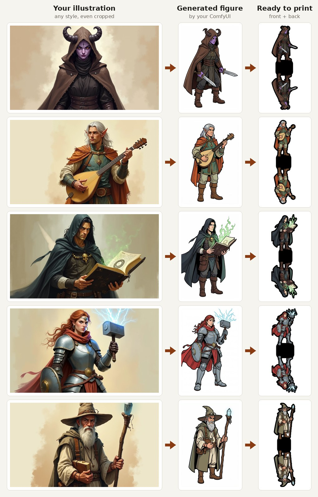
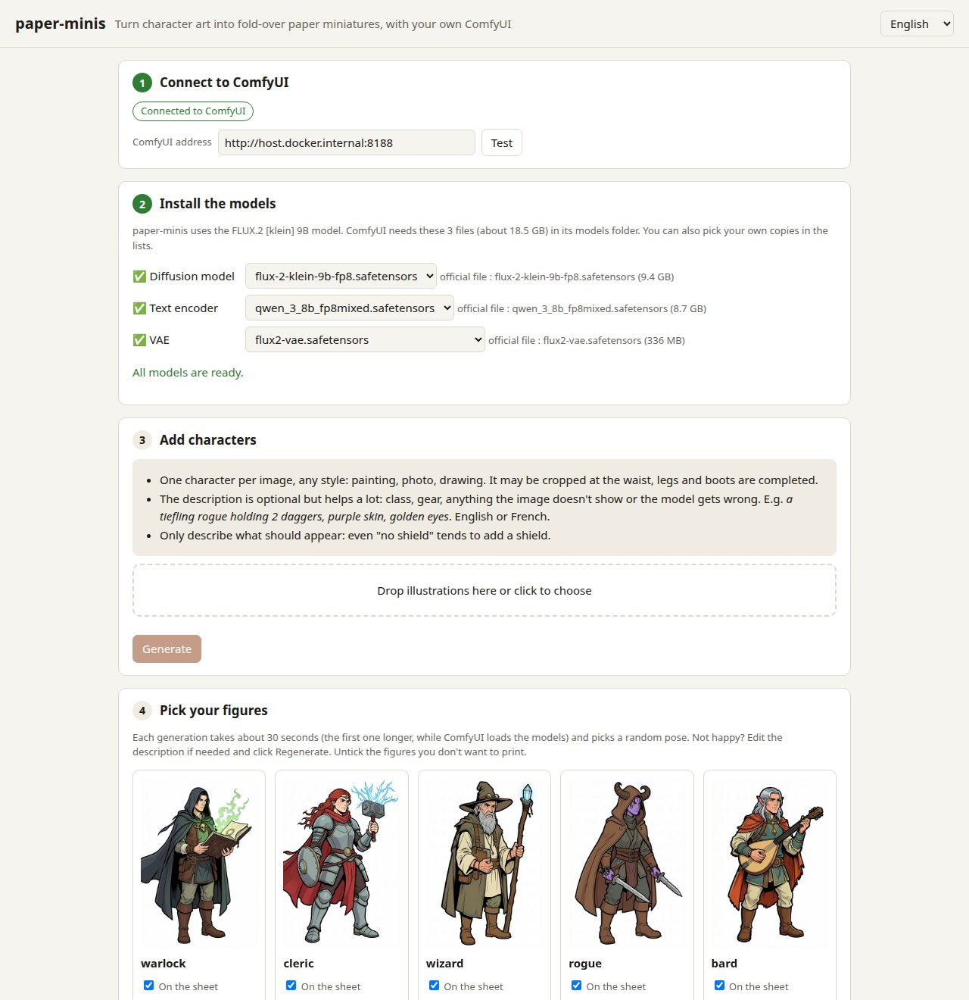
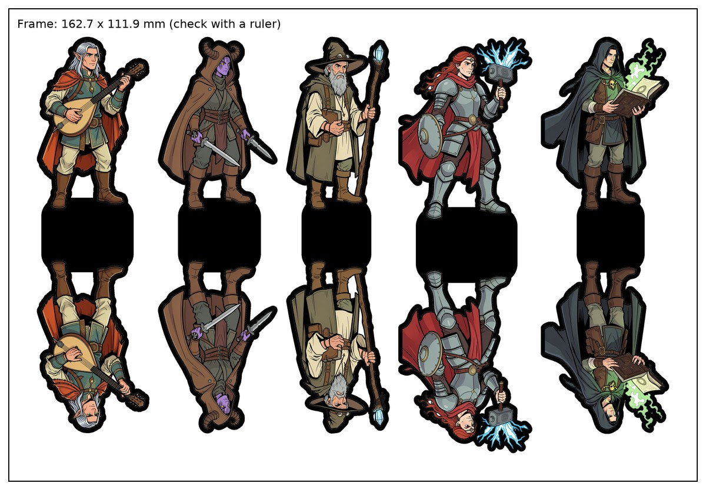

# paper-minis

Turn character illustrations into **fold-over paper miniatures** for tabletop games, using your own
[ComfyUI](https://github.com/Comfy-Org/ComfyUI) and the FLUX.2 [klein] 9B image model.



Upload character images, each with an optional description. paper-minis draws a clean full-body figure of each one, then gives you print-ready sheets:

- **PDF / PNG sheets** at true size. Each figure gets a black border, a black base, and a mirrored back side joined at the base.
- A **laser-cut SVG** matching each sheet, with a registration frame, the cut lines and the fold lines.

The web page walks you through everything, in English or French: connecting ComfyUI, installing the models, then
generating, printing, cutting and assembling.





## Quick start

1. Install [Docker](https://docs.docker.com/get-docker/).
2. Start paper-minis:
   ```bash
   docker run -d --name paper-minis -p 8080:8080 --add-host host.docker.internal:host-gateway \
     -v paper-minis-data:/data --restart unless-stopped ghcr.io/kynesilverhide/paper-minis
   ```
   Or with Docker Compose: download [`docker-compose.yml`](docker-compose.yml) and run `docker compose up -d` next to it.
3. Open <http://localhost:8080> and follow the steps on the page.

You also need ComfyUI (free) running on a computer with a capable graphics card: about 24 GB of video memory is comfortable,
12–16 GB works more slowly. The page explains how to install ComfyUI, connect it and get the models.

paper-minis itself needs no graphics card: it can run on the same computer as ComfyUI, or on a small always-on machine (NAS, home server, even a Raspberry Pi) that sends the work to ComfyUI on your gaming PC. The image is available for x86-64 and ARM64.

## How it works

```
browser ──► paper-minis (Docker, port 8080) ──HTTP──► your ComfyUI ──► your GPU
```

The container only holds the web page and the image post-processing, so it needs no GPU and doesn't care which GPU ComfyUI runs on.
Image generation runs in your own ComfyUI, using core nodes only: there is nothing to install in ComfyUI.

## Settings

All optional, in `docker-compose.yml` or as environment variables:

| Setting | Default | |
|---|---|---|
| `PORT` | `8080` | Web page port, e.g. `PORT=8090 docker compose up -d`. |
| `COMFYUI_URL` | `http://host.docker.internal:8188` | Initial ComfyUI address. You can change it from the page. |
| `COMFYUI_MODELS_DIR` | unset | Set to `/models` and mount your `ComfyUI/models` folder there to download models from the page. |
| `PUID` / `PGID` | `1000` | User the app runs as (`id -u`, `id -g`), so downloaded models belong to you. |
| `MAX_UPLOAD_MB` | `25` | Largest accepted upload. |

Figures and sheets are kept in the `paper-minis-data` Docker volume, so they survive updates.

To update: `docker compose pull && docker compose up -d` (with `docker run`: `docker pull ghcr.io/kynesilverhide/paper-minis`, then remove and recreate the container).

To change the code, clone this repository and use `build: .` in `docker-compose.yml`, then `docker compose up -d --build`.

The app has no login: anyone who can reach its port can use it. Keep it on your own computer or home network.

## Licenses

- paper-minis: MIT (see `LICENSE`).
- The FLUX.2 [klein] 9B model is free for non-commercial use under the
  [FLUX Non-Commercial License](https://huggingface.co/black-forest-labs/FLUX.2-klein-9b-fp8). Each user accepts it on Hugging Face before downloading.
  paper-minis does not distribute any model weights.

## En français

paper-minis transforme des illustrations de personnages en **figurines en papier pliables** pour le jeu de rôle,
avec ton propre ComfyUI. Installe Docker, lance la commande `docker run` ci-dessus (ou `docker compose up -d`), ouvre <http://localhost:8080> :
la page, disponible en français, te guide pas à pas. Elle explique comment installer et connecter ComfyUI, récupérer les modèles, puis générer, imprimer, découper et assembler.
